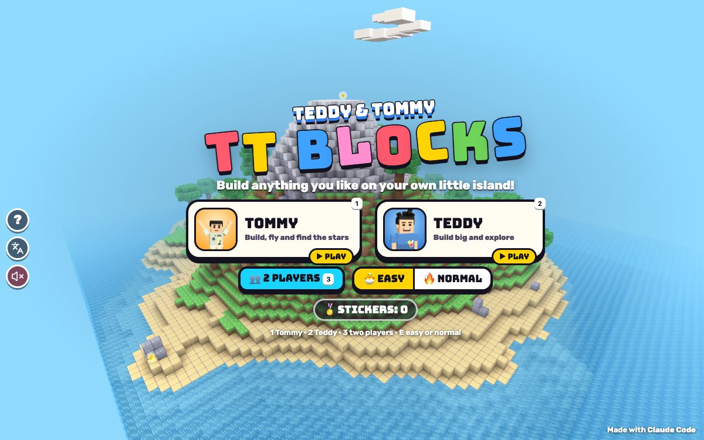

# TT Blocks

Press **?** any time (or tap the round **?** button on the left edge) to see the keys. The game waits while you look.
Tap the language button under it (the A文 icon) to switch between English and 中文; the dashboard and every game remember the choice.

A block-building world on a little island of your own: dig, build, fly, find the five golden stars and make friends with puffy sheep, chicks and sleepy cats. Each island comes from a seed (any words you type), so the same words always make the same island. There are no monsters, no fighting and no hunger: just building.

**中文：** 方块建造世界：在你自己的小岛上挖、放置、飞行、建造，找到 5 颗金星星，和小羊、小鸡、爱睡觉的小猫交朋友；随时可以叫兄弟来帮你建造。

The game stars Teddy and Tommy. It's built with Claude Code from plain JavaScript and Three.js, on the shared Claude Games kit (the blocky boys, their poses, synth sound, the ? keys panel and English / 中文). There are no image, model or sound files: the block art is painted on canvases when the page starts, the animals are made of soft boxes, and every sound is synthesised. It was inspired by the famous block-building games, but the name, the blocks, their art, the animals and everything else here are our own.

The name lives in one place, `BT.TITLE` / `BT.NAME` in `js/title.js`.

## Play

- **Double-click `index.html`.** It works offline, because Three.js and the kit are copied into `kit/`. Without internet the title font falls back to Arial Black.
- **Send one file:** `dist/blocks-tt.html` is the whole game in one page, about 0.9 MB. AirDrop or email it, then open it in a browser.
- **Rebuild that file after any edit:** `python3 kit/tools/bundle.py . --name blocks-tt`

On the title screen tap **TOMMY** or **TEDDY** (or **👥 2 PLAYERS**), and **🐣 EASY** or **🔥 NORMAL**. Then **MY WORLDS**:

- **➕ NEW WORLD:** type any words as the seed (or roll the 🎲) and tap **MAKE IT!**
- **▶ PLAY** carries on with a saved world. 🗑️ deletes one (tap it twice).

**Saving (存档):** several worlds, in the browser's `localStorage`: the list under `blocksTT.v1.worlds`, each world under `blocksTT.v1.w.<id>`. A world saves only its seed and the blocks that differ from the island the seed makes, so even a big build is small. It saves every 15 seconds, when you pause, leave or hide the page, and with **💾 SAVE** on the pause screen. With storage blocked (a private window) it still plays and keeps the world until the page closes.

**🐣 EASY** (the default, for Tommy): you always fly, nothing can hurt you (nothing can anyway), and a see-through ghost block shows where your block will go. **🔥 NORMAL** (for Teddy): you walk, jump and double-tap jump to fly. Each brother can switch on the pause screen.

**2 players** share one world and take turns: tap **🔄** (or Tab) to swap. Each has his own spot, hotbar and EASY or NORMAL, and you can see the other brother standing where he was, with his name over his head.

**The island** is 96 × 96 blocks and 48 high: a sandy beach all round, rolling grassy hills, a mountain with a snowy top and bare stone where it's steep, up to two dozen round trees, a pond and a little cave in the mountainside with a lamp in its room. Beyond it is the sea. **Day and night:** the sun and the moon cross the sky (a whole day is 7 minutes, two thirds of it daytime), the stars twinkle at night and lamps glow. **N** or 🌙 / ☀️ skips to morning or night.

**The animals** are our own: puffy sheep graze and wander, chicks hop after you, and sleepy cats nap in the sun (💤), wake for a stretch when you come close, then curl up again. Tap or click one to pet it (💖). They hop up one-block steps, stay out of the water and pop up on top if you build over them.

## Blocks

16 blocks, all our own soft, bright, chunky art: grass, dirt, stone, sand, wood, leaves, planks, glass (see-through), brick, a lamp (glows, and lights up the blocks around it at night), water (it stays where you put it), snow, and four bright colour blocks: red, yellow, blue and pink.

The hotbar holds 9 (start: grass, planks, brick, glass, lamp and the four colours). **E** or 🎒 opens all 16: tap one to put it in the yellow slot.

**The helpers:**

| | What it does |
|---|---|
| ↩️ **UNDO** (Z) | puts the last change back, however big (a fill, a mirrored pair, the brother's whole house) |
| 📦 **FILL** (F) | PLACE on one corner, then the other: the box between fills with your block. BREAK on two corners empties a box instead. Up to 20 blocks a side. |
| 🦋 **MIRROR** (G) | a stripy line through the block you point at, running the way you look: whatever you build or dig on one side appears on the other |
| 📏 **RULER** (R) | point at a block and tap PLACE or BREAK, then another: it shows how many blocks across, up and deep (handy for the tower) |

The bottom layer of the island can't be dug, so nobody falls out of the world, and a block never goes where someone is standing.

## Quests

Tommy's gentle quests (for Teddy too), each checked by the game. Finishing one gives a cheer, confetti, a sticker, and the camera swings round so you see yourself do your signature move. All three: **ALL THE QUESTS DONE!** with **PLAY AGAIN** (a new world) or **KEEP BUILDING**. The title shows the running score: 🏅 every sticker in every world.

| Quest | Sticker | How the game checks it |
|---|---|---|
| ⭐ **Find 5 golden stars hidden on the island** | 🌟 | Walk or fly right up to one. They're in the cave's room, on top of the tallest tree, on the mountain top, on the far beach behind some boulders, and at the bottom of the pond. **H** (or ⭐ SHOW ME A STAR on the quest card) puts a golden light over the nearest one. |
| 🏠 **Build a house with a door** | 🏡 | A room closed in by walls, a floor and a roof, with a doorway 1 block wide and 2 high leading outdoors, and no other holes. Most of the room's walls must be blocks you put there, so the cave doesn't count. Glass windows are fine. |
| 🗼 **Make a tower 10 blocks high** | 🏰 | 10 blocks you put there, one on top of the other with no gap. |

Tap the quest chip at the top (or **Q**) to see the quests and how far along you are.

## Controls

| | Keys | Touch / mouse |
|---|---|---|
| walk | W A S D (↑ ↓ too) | the stick, bottom left |
| look around | the mouse (click the world once; Esc lets go), ← → turn | drag anywhere |
| break · place | left click · right click (hold to keep going) | ⛏️ BREAK · 🧱 PLACE (hold to keep going) |
| jump · fly up · fly down | Space · hold Space · Shift (or C) | ⬆️ JUMP · hold it · ⬇️ DOWN |
| fly on or off (🔥 NORMAL) | double-tap Space | double-tap JUMP |
| pick a block · all the blocks · copy the block you point at | 1 – 9 or the wheel · E · middle click or X | tap a slot · 🎒 |
| undo · fill · mirror · ruler | Z · F · G · R | ↩️ 📦 🦋 📏 (on a phone: 🛠️ first) |
| call your brother · pick what he builds | T · B (or Shift + T) | his face, top left · ▾ |
| quests · show me a star | Q · H | the quest chip at the top |
| camera (you, from behind) · day or night | V · N | 🎥 · 🌙 / ☀️ |
| swap turns (2 players) | Tab | 🔄 |
| sound · pause | M · P or Esc | 🔊 · ⏸️ |
| title: Tommy · Teddy · 2 players · easy or normal | 1 · 2 · 3 · E | the buttons |

The sound switch is the kit's: the 🔊 at the top right while you play, and the kit's speaker button (under A文) on the menus. M works everywhere. Without pointer lock (some browsers) dragging with the mouse looks around and a click breaks or places.

## Companion: call your brother

Call him any time, as often as you like, with **T** or **his face** (top left). He's `Kit.roster.buddyFor(you)`: Tommy when Teddy plays, Teddy when Tommy plays.

1. **He pops in** beside where you're looking, at his roster size (`buddyScale`), and does his signature move: Teddy's boxing or 🏀 jump shot, Tommy's Y with ✌️.
2. **He tosses you a treat:** 🍦 💧 🧃 🍪 🍉 or 🍌 ("🍪 COOKIE FROM TOMMY!").
3. **He builds a ready-made piece where you're looking,** block by block from the ground up: a little house (planks, glass windows, a red roof, a lamp inside and a yellow doormat), a brick tower 12 high with a lamp on top, a plank bridge with lamp posts, or an apple tree. **T** picks one at random; **B** or **▾** lets you choose. "TOMMY SAYS: I BUILT YOU A HOUSE!"
4. **He waves goodbye** and pops away. One **UNDO** takes the whole piece away again.

His house and tower count for the quests, so Tommy can always get his stickers with a little help. When both brothers play, he's already there, so **T** is a **HIGH FIVE**: he pops over beside you, you both wave, and confetti.

## How it works, and how it's tested

- **The rules have no Three.js and no page,** so they run headless in node: `js/world.js` (the seeded island, the light), `js/mesher.js` (greedy meshing), `js/quests.js`, `js/build.js` (place, dig, fill, mirror, undo, the ready-made pieces), `js/player.js` (walking, flying, the crosshair's ray), `js/animals.js`, `js/save.js` and `js/session.js` (one world being played).
- **Drawing:** the world is cut into 16 × 16 × 16 chunks. Each chunk is meshed with only the faces you can see, then greedy meshing merges matching faces into big rectangles; a shader repeats the tile once per block (from a WebGL2 texture array, with mipmaps) and adds corner shading, sunlight, lamplight and fog. Sunlight and lamplight spread block by block (0–10); an edit relights only the columns within reach of it and redraws just the chunks whose blocks or light changed, nearest first. An iPad that can't keep up draws fewer pixels.
- **The check:** `node tools/check.js` (about 3 seconds), or `game.check()` in the page, which also times drawing the big build. It checks:
  - **world:** the same seed makes the very same island (blocks, stars, animals, start), a different seed a different one; every island has its hills, beach, trees, pond, cave, snow, 5 stars and open ground to start on;
  - **mesh:** a test chunk's face count (173) matches the count worked out by hand and the slow one-face-at-a-time count, face for face (no missing faces, no hidden ones drawn, none twice); the same for all 108 chunks of 3 islands;
  - **edits:** placing and breaking on a chunk's edge (x, y and z) redraws the chunk next door, its face count goes down and back up by one, and the light after edits matches a full relight;
  - **save:** 300 edits, a fill and a house, saved and loaded, give back the same blocks, light, players, turn, time, stars and quests; blocked storage and a broken save don't crash;
  - **quests:** right builds pass and wrong ones are turned down (a 9-high tower, a tower with a gap, the island's own stone, a box with no door, no roof, a 1-high door, a hole in the wall, the cave);
  - **tools, body, animals:** undo, fill, mirror, the ruler and each piece in every facing; falling, steps, walls, jumping, flying, EASY, the world's edge, being built over; 3000 frames of animals staying on the island, out of blocks and water, and the cat waking up;
  - **frame:** a big build (about 7,300 placed blocks: 40 pieces and 24 patchwork walls) stays within budget: a frame of play 0.5 ms on average (budget 6), the worst edit 4–5 ms (30), the slowest chunk 2–8 ms (12), the whole island 70–100 ms (700), 76,000 triangles (400,000); drawing it in the page took 1.9 ms a frame (33).
  - **Proving it can fail:** 11 sabotage switches (the island ignores the seed, the mesher drops a face or draws a hidden one, an edit forgets its neighbour, saving loses a change, a tower of 9 counts, a house with no door or no roof counts, stars found from far away, undo does nothing, frames waste 20 ms). `node tools/check.js` runs them all and each one must make the check fail.
- **The page:** `game.tour('zh')` visits every screen (title, worlds, play, the tools, the picker, quests, the brother's menu and his visit, pause, a cheer, all done, the ? panel, 2 players) and returns `Kit.lang.untranslated()` (it returned `[]`). `game.layout()` checks the HUD, the kit's left-edge buttons and the touch controls don't overlap; it caught several real overlaps on a phone and an iPad before they were fixed, and now comes back clean at 390 × 844, 740 × 360, 1024 × 768, 768 × 1024 and 1200 × 750.
- **Screenshot:** `node tools/shoot.js tools/shots.json docs 1200 750` (headless Chrome, muted).

## Not verified

- **Hearing it.** Every test ran muted; nobody has listened to the sounds or the music.
- **Real devices and real kids.** Touch, the joystick and the iPad's speed were simulated in a desktop browser, not tried on an iPad or a phone. Whether EASY and NORMAL, the quests and the controls suit a 5- and an 8-year-old is untested with the boys.
- **The mouse for real.** Pointer lock (click to look, Esc to let go, holding a button to keep building) needs a real mouse in a real browser window; the tests drove the same code through `game.act()` and the input hooks.
- **Drawing speed on an iPad.** The frame budget was measured on this Mac (logic in node and the page, drawing in the browser); the iPad's own frame rate is a guess.
- **The 中文** was written by hand (kid-friendly, checked for completeness), not by a native-speaking teacher. "MY WORLDS" is 世界存档, to stay clear of the famous game's own Chinese name.
- **The ? panel's freeze** comes from the shared kit and wasn't re-tested here.
- **Long play.** Saves were tested across reloads in the browser, but not over weeks of real play or with storage filling up.
